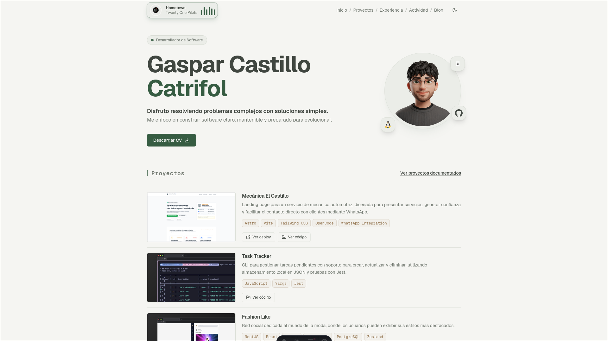
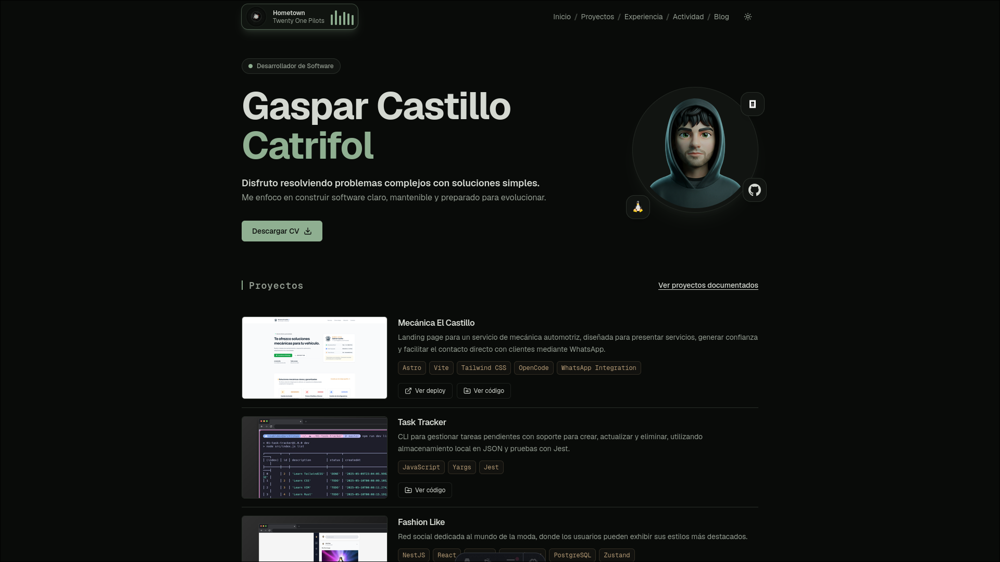

<div align="center">
  <h1>Portfolio — Gaspar Castillo</h1>
</div>

<p align="center">
  Portfolio personal y blog de <a href="https://github.com/isakiDev">Gaspar Castillo</a>, desarrollador de software enfocado en crear productos claros, bien pensados y fáciles de mantener.
  <br />
  <a href="https://isakidev.vercel.app"><strong>Ver sitio en vivo →</strong></a>
</p>

<p align="center">
  
  
  
  
</p>

<div align="center">
  <table>
    <tr>
      <td>
        <a href="https://isakidev.vercel.app">
          
        </a>
      </td>
      <td>
        <a href="https://isakidev.vercel.app">
          
        </a>
      </td>
    </tr>
    <tr>
      <td align="center"><strong>Modo claro</strong></td>
      <td align="center"><strong>Modo oscuro</strong></td>
    </tr>
  </table>
</div>

## Características

- **Landing page** — secciones de hero, proyectos, experiencia, actividad y blog.
- **Proyectos** — listado y páginas de detalle generadas desde content collections en Markdown.
- **Blog** — notas en Markdown con fecha, tags, tiempo de lectura y tabla de contenidos.
- **Activity Log** — últimos commits públicos desde GitHub, cargados con `server:defer`.
- **Now Playing** — canción actual de Spotify en el header, con fallback cuando no hay reproducción.
- **Tema claro/oscuro** — toggle persistido en `localStorage`, con soporte para preferencia del sistema.
- **SEO base** — metadata Open Graph/Twitter, URL canónica e icono configurable.

## Stack

- [Astro](https://astro.build) 7 con adapter de [Vercel](https://vercel.com)
- [TypeScript](https://www.typescriptlang.org)
- [Tailwind CSS](https://tailwindcss.com) 4
- [astro-expressive-code](https://expressive-code.com) para bloques de código
- [astro-mermaid](https://github.com/jojojojojojosh/astro-mermaid) + [Mermaid](https://mermaid.js.org) para diagramas
- [Geist](https://vercel.com/font) como tipografía variable

## Requisitos

- [Node.js](https://nodejs.org/) 20+
- [pnpm](https://pnpm.io/)

## Desarrollo local

```bash
pnpm install
pnpm dev
```

El servidor de desarrollo queda disponible en la URL que indique Astro.

## Scripts

```bash
pnpm dev      # inicia el entorno de desarrollo
pnpm build    # genera la build de producción
pnpm preview  # previsualiza la build
pnpm check    # ejecuta diagnósticos de Astro/TypeScript
```

## Variables de entorno

Crea un archivo `.env` a partir de `.env.example`:

```bash
cp .env.example .env
```

```env
GITHUB_TOKEN=          # Token de GitHub para obtener commits recientes
SPOTIFY_CLIENT_ID=     # Credenciales de Spotify para Now Playing
SPOTIFY_CLIENT_SECRET=
SPOTIFY_REFRESH_TOKEN=
```

> Si faltan credenciales, las secciones dependientes de APIs externas degradan con gracia: Activity Log puede quedar vacío y Now Playing muestra un estado fallback.

## Estructura del proyecto

```text
.
├── public/                 # assets estáticos (imágenes, CV, robots.txt)
├── src/
│   ├── components/         # componentes compartidos de UI/layout
│   │   ├── icons/          # iconos SVG/Astro
│   │   └── ui/             # primitivas reutilizables
│   ├── config/             # configuración del sitio y metadata
│   ├── content/            # content collections (blog, projects)
│   ├── features/           # módulos por dominio
│   │   ├── blog/           # sección, listado y tarjetas de blog
│   │   ├── portfolio/      # hero, experiencia, actividad, now playing
│   │   └── projects/       # listado y detalle de proyectos
│   ├── layouts/            # layout base HTML/SEO/tema
│   ├── pages/              # rutas Astro
│   ├── styles/             # estilos globales y tokens de tema
│   ├── utils/              # utilidades compartidas (fechas, SEO, lectura)
│   └── content.config.ts   # esquema de colecciones
├── astro.config.mjs
├── package.json
└── tsconfig.json
```

## Contenido

- **Blog**: agregar entradas en `src/content/blog/<slug>/index.md`.
- **Proyectos**: agregar entradas en `src/content/projects/<slug>/index.md`.
- Los esquemas y campos disponibles están definidos en `src/content.config.ts`.

## Deploy

El proyecto está configurado para desplegarse en Vercel mediante `@astrojs/vercel`. Para producción, asegúrate de definir las variables de entorno necesarias en el panel del proyecto.